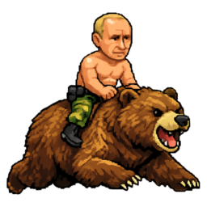

<h1 align="center">Nikola Dukić</h1>

  Student FON-a · full-stack i data projekti

---

## Projekti

<table>
  <tr>
    <td align="center" width="150">
      <a href="https://github.com/dukanx/Hearth">
         
        <b>Hearth</b>
      </a> 
      Organizacija domaćinstva .NET · React
    </td>
    <td align="center" width="150">
      <a href="https://github.com/dukanx/Second-Brain">
         
        <b>Second Brain</b>
      </a> 
      AI baza znanja Next.js · Supabase
    </td>
    <td align="center" width="150">
      <a href="https://github.com/dukanx/NJT">
         
        <b>GlumacPlus</b>
      </a> 
      Naručivanje hrane Spring Boot · Angular
    </td>
    <td align="center" width="150">
      <a href="https://github.com/dukanx/Village-Booker">
         
        <b>Village Booker</b>
      </a> 
      Rezervacije smeštaja Spring Boot · Gradle
    </td>
  </tr>
  <tr>
    <td align="center" width="150">
      <a href="https://github.com/dukanx/FON_raspored">
         
        <b>FON Raspored</b>
      </a> 
      Raspored časova na FON-u Next.js
    </td>
    <td align="center" width="150">
      <a href="https://github.com/dukanx/NAP">
         
        <b>NAP</b>
      </a> 
      Analiza IT tržišta rada Python · LLM · mrežna analiza
    </td>
    <td align="center" width="150">
      <a href="https://github.com/dukanx/srecna-biljka">
         
        <b>Srećna biljka</b>
      </a> 
      IoT senzor za biljke ESP32 · Flask
    </td>
    <td align="center" width="150">
      <a href="https://github.com/dukanx/putin-bear">
         
        <b>Putin Bear</b>
      </a> 
      Browser igrica Vanilla JS · PWA
    </td>
  </tr>
</table>
