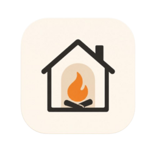
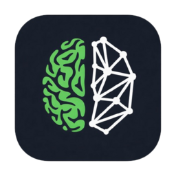

<h1 align="center">Nikola Dukić</h1>

  <b>Software Engineer · Belgrade, Serbia</b> 
  Full-stack development · Data analysis · LLM-based systems

  
  

Finishing my B.Sc. in Software Engineering at the University of Belgrade (FON), with practical
experience across the full stack. I like building things end to end: REST APIs and relational databases
underneath, modern frontends on top, increasingly LLM-assisted data workflows in between.... 

You've probably seen the polished version on my resume already.
Now let's take a look at what I've actually been building lately.

I'm currently interning as an **AI Developer at Appworks**, working on a Python backend for AI-driven
media processing: transcription, translation, subtitling, video dubbing...
On the side, turning my job-market analysis into a bachelor's thesis on salary prediction, while preparing my family's food ordering app for production.

## Tech Stack

|  |  |
|---|---|
| **Languages** |      |
| **Frontend** |    |
| **Backend** |      |
| **Architecture** |    |
| **Databases** |     |
| **Data & AI** |      |
| **Testing** |   |
| **DevOps** |        |

## Projects

<table align="center" width="100%">
  <tr>
    <td align="center" valign="top" width="33%">
      <a href="https://github.com/dukanx/GLUMAC-PLUS">
         
        <b>Glumac Plus</b>
      </a>
      
Restaurant ordering and management system with a customer app, 
      staff dashboard and loyalty program 
      <i>Spring Boot · React · PostgreSQL · JWT</i>

    </td>
    <td align="center" valign="top" width="33%">
      <a href="https://github.com/dukanx/fon-raspored">
         
        <b>FON Raspored</b>
      </a>
      
Installable class schedule PWA with web push, built on a custom 
      PDF parser and scheduled scraping 
      <i>Next.js · Python · GitHub Actions</i> 
      <a href="https://fonraspored.rs">live app ↗</a>

    </td>
    <td align="center" valign="top" width="33%">
      <a href="https://github.com/dukanx/Napredna_analiza_podataka_Projekat-Job_Postings_Analysis">
         
        <b>Job Market Analysis</b>
      </a>
      
LLM feature extraction and technology co-occurrence networks 
      over IT job postings 
      <i>Python · Groq · NetworkX · pandas</i>

    </td>
  </tr>
  <tr>
    <td align="center" valign="top" width="33%">
      <a href="https://github.com/dukanx/Hearth">
         
        <b>Hearth</b>
      </a>
      
Household organizer with shared tasks, role-scoped permissions 
      and realtime notifications 
      <i>.NET · Clean Architecture · SignalR · React</i> 
      <a href="https://hearth-production-3819.up.railway.app">live app ↗</a>

    </td>
    <td align="center" valign="top" width="33%">
      <a href="https://github.com/dukanx/Second-Brain">
         
        <b>Second Brain</b>
      </a>
      
AI knowledge capture tool that surfaces connections between 
      notes, links and tasks 
      <i>Next.js · Supabase · LLM APIs</i> 
      <a href="https://second-brain-three-pi.vercel.app">live app ↗</a>

    </td>
    <td align="center" valign="top" width="33%">
      <a href="https://github.com/dukanx/srecna-biljka">
         
        <b>Srećna biljka</b>
      </a>
      
IoT plant monitor that pushes a notification the moment the 
      plant's state changes 
      <i>ESP32 · Flask · PostgreSQL · Web Push</i>

    </td>
  </tr>
</table>

<b>More projects</b>

 

**[SentinelFlow](https://github.com/dukanx/SentinelFlow-fintech-hackathon)** · Crypto sanctions & AML screening *(Garaža Hack, 2026)*
A compliance console that screens Solana deposits for sanctions exposure, tracing senders through a
simulated on-chain transaction graph to produce a deterministic, explainable risk verdict. Includes
behavioral identity-linking and zk-STARK "proof-of-innocence" for private deposits.
`React` `TypeScript` `FastAPI` `NetworkX` · [video demo ↗](https://www.loom.com/share/a16fba140af24a01882342c3a6afbe61)

**[Running Partner Finder](https://github.com/dukanx/Partneri-za-trcanje)** · Full-stack runner-matching web app
JWT auth, Leaflet maps, Cloudinary image hosting, Swagger/OpenAPI docs. Multi-layer security work
(CSRF, IDOR, XSS), dockerized with a GitHub Actions pipeline deploying to Render.
`Next.js` `TypeScript` `Prisma` `Docker` · [live app ↗](https://trep-app.onrender.com/)

**Pancake Shop Management System** · Java client-server system over raw sockets
Real-time client/server communication, authentication, and database-backed operations behind a Swing GUI.
`Java` `Sockets` `MySQL` `Swing`

**[Custom grep](https://github.com/dukanx/GREP)** · Simplified Unix `grep` with substring search and basic pattern matching.
`C`

## Education & Experience

| | |
|---|---|
| **Ninth Gymnasium "Mihailo Petrović Alas"**, Natural Sciences & Mathematics | 2018 - 2022 |
| **B.Sc. Software Engineering**, University of Belgrade, FON | 2022 - 2026 |
| **Co-owner & Technical Lead**, Glumac Plus *(family restaurant; building its ordering system)* | 2023 - present |
| **AI Developer Intern**, Appworks *(Python backend for AI media processing)* | 2026 - present |
